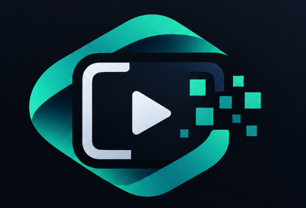

# OmniVerify — Intelligent Multi-Dimensional Analysis for DeepFake Video Identification

<div align="center">
  
  <h3>Digital Video Forensics & Explainable AI Verification Platform</h3>
  <p><b>Academic Year: 2026–27</b> &bull; <i>Windows CPU Inference Optimized</i></p>
</div>

---

## 1. Executive Summary

As generative diffusion architectures and video world models (e.g. OpenAI Sora, Kling, Runway Gen-3) advance, synthetic manipulation has expanded beyond simple facial swaps to full-scene generative diffusion and temporally localized video splices. Conventional face-centric classifiers fail catastrophically on out-of-distribution generators because they ignore background structures, physical object continuity, and sensor-level forensic artifacts.

**OmniVerify** addresses this challenge by implementing an intelligent, multi-dimensional forensic analysis platform that leads with **signal-processing principles and physical sensor invariants**:
- **Full-Scene Object Intelligence:** Evaluates people, vehicles, background context, and object co-occurrence continuity using COCO 80 categories (SSDLite-MobileNetV3 / YOLO).
- **Sensor Pattern Noise (PRNU) Residuals:** Isolates high-pass camera noise to identify synthetic spatial smoothing and localized blending cliffs.
- **Gunnar-Farneback Dense Optical Flow & SSIM:** Measures inter-frame motion velocity continuity and flags high-frequency generative motion tears with millisecond precision.
- **2D Fourier (FFT) Radial Spectral Forensics:** Analyzes high-to-low radial power decay $P(r)$ to expose transposed-convolution checkerboard grid harmonics.
- **Calibrated Bayesian Log-Odds Evidence Fusion:** Combines independent forensic dimensions into a defensible three-tier determination (`REAL`, `MANIPULATED`, or `UNCERTAIN`) calibrated via Platt scaling.
- **Professional Bento Grid Interface:** React 18 + Vite dashboard styled in the official Cyprus Green (`#004741`) & Sand (`#F0EDE4`) design system, featuring an interactive frame timeline, spatial heatmaps, and downloadable forensic dossiers.

---

## 2. System Architecture

```
                                      +---------------------------------------------+
                                      |             React + Vite Frontend           |
                                      |     (Bento Grid, Video Player, Timeline)    |
                                      +----------------------+----------------------+
                                                             | HTTP / REST API
                                                             v
+-------------------------------------------------------------------------------------------------------------------------+
|                                                   FastAPI Backend Core                                                  |
|                                                                                                                         |
|  +--------------------+        +---------------------------------+        +------------------------------------------+  |
|  | Video Ingestion &  | -----> |   Bounded Two-Pass Frame        | -----> |        Multi-Signal Forensic Engine      |  |
|  | Format Validation  |        |   Sampling & Timestamp Tracking |        |                                          |  |
|  +--------------------+        +---------------------------------+        +--+----------------+-------------------+--+  |
|                                                                              |                |                   |     |
|              +---------------------------------------------------------------+                |                   |     |
|              |                                                                                |                   |     |
|              v                                                                                v                   v     |
|  +-----------------------+     +-----------------------+     +------------------------+       |     +----------------+  |
|  | 1. Scene & Object     |     | 2. Sensor Noise       |     | 3. Temporal Optical    |       |     | 4. Frequency   |  |
|  | Detector (COCO 80)    |     | Residual (PRNU)       |     | Flow (Farneback + SSIM)|       |     | Domain (2D FFT)|  |
|  +-----------+-----------+     +-----------+-----------+     +-----------+------------+       |     +-------+--------+  |
|              |                             |                             |                    |             |           |
|              +-----------------------------+--------------+--------------+--------------------+-------------+           |
|                                                           |                                                             |
|                                                           v                                                             |
|                                        +--------------------------------------+                                         |
|                                        | 5. Multi-Signal Evidence Fusion      |                                         |
|                                        | (Calibrated Bayesian Log-Odds Head)  |                                         |
|                                        +------------------+-------------------+                                         |
|                                                           |                                                             |
|                                                           v                                                             |
|                                        +--------------------------------------+                                         |
|                                        | 6. Traceable Explainability Engine   |                                         |
|                                        | (Timestamps, Heatmaps, Verdict:      |                                         |
|                                        |  Real / Manipulated / Uncertain)     |                                         |
|                                        +------------------+-------------------+                                         |
|                                                           |                                                             |
|                                                           v                                                             |
|                                        +--------------------------------------+                                         |
|                                        | 7. Forensic Dossier & Report Service |                                         |
|                                        | (JSON + HTML / PDF Verification Docs)|                                         |
|                                        +--------------------------------------+                                         |
+-------------------------------------------------------------------------------------------------------------------------+
```

---

## 3. Brand Identity & Design System

The OmniVerify interface is built to evoke an authoritative digital forensics laboratory workbench:
- **Cyprus Green (`#004741`):** Primary brand anchor, primary action buttons, key forensic focus highlights.
- **Sand (`#F0EDE4`):** Warm neutral light canvas, secondary card surfaces, report background.
- **Deep Teal (`#003B36`):** Sidebar navigation, elevated dark panels, hover states.
- **Ink (`#101816`):** High-contrast primary typography and terminal base.
- **Muted Teal (`#6D9A91`):** Secondary borders, metadata tags, metric indicator bars.
- **Soft White (`#FAF9F5`):** Primary Bento Grid card surfaces.
- **Official Brand Asset:** User-provided master logo (`frontend/public/assets/omniverify_logo.png`) integrated without AI replacement or distortion.

---

## 4. Quick Start & Windows Installation

### Prerequisites
- Python 3.10+ (Tested on Python 3.14 on Windows 11)
- Node.js v18+ (Tested on Node v22)
- Git 2.40+

### Step 1: Clone Repository
```powershell
git clone https://github.com/Modepalli-Ravindra/OmniVerify.git
cd OmniVerify
```

### Step 2: Backend Setup
```powershell
# Install backend dependencies
python -m pip install -r backend/requirements.txt

# Run backend automated pytest suite
python -m pytest backend/tests -v

# Start FastAPI backend server (port 8000)
python -m uvicorn backend.app.main:app --host 127.0.0.1 --port 8000 --reload
```

### Step 3: Frontend Setup
In a second PowerShell terminal:
```powershell
cd frontend
npm install
npm run build
npm run dev
```
Open browser to `http://localhost:3000` to access the OmniVerify Forensic Dashboard.

---

## 5. Verification & Automated Testing

The OmniVerify test suite covers every layer of the architecture:
```powershell
python -m pytest backend/tests -v
```

Test modules:
- `backend/tests/test_video_processing.py`: Ingestion, OpenCV frame decoding, SHA-256 chain-of-custody, bounded sampling.
- `backend/tests/test_object_detector.py`: COCO 80 object detection, bounding box normalization, temporal scene jitter.
- `backend/tests/test_forensics.py`: High-pass Gaussian PRNU noise residuals and 2D FFT radial power decay.
- `backend/tests/test_temporal_flow.py`: Gunnar-Farneback optical flow motion magnitude and Structural Similarity (SSIM).
- `backend/tests/test_evidence_fusion.py`: Bayesian log-odds head, Platt scaling, Real/Uncertain/Manipulated decision boundaries, and suspicious interval clustering.
- `backend/tests/test_api.py`: FastAPI endpoints, upload validation, end-to-end analysis, and JSON/HTML dossier generation.

---

## 6. Project Documentation & Artifacts

- **[docs/audit_and_selection.md](docs/audit_and_selection.md):** Repository audit comparing `veriFi`, `temporally-localized-video-manipulation-detection`, and `DeepfakeBench`.
- **[docs/requirements_traceability_matrix.md](docs/requirements_traceability_matrix.md):** Complete client requirements traceability matrix mapping all IDs to source code and tests.
- **[docs/architecture_and_data_flow.md](docs/architecture_and_data_flow.md):** In-depth technical architecture, mathematical formulations, and signal flow diagrams.
- **[docs/brand_identity.md](docs/brand_identity.md):** Brand color tokens, typography, and logo usage guidelines.

---

## 7. Open-Source Attribution & Licensing

OmniVerify adapts and synthesizes concepts from the following open-source projects:
- **veriFi (`heisenberg1804`):** Multi-signal forensic philosophy and two-pass bounded sampling architecture (MIT License).
- **Temporally Localized Video Manipulation Detection (`OkanUmur`, arXiv:2606.07090):** Dense temporal interval boundary tracking methodology.
- **DeepfakeBench (`SCLBD`, NeurIPS 2023 D&B):** Evaluation metrics and forensic benchmarking standards.

**License:** MIT License. See [LICENSE](LICENSE) for details.
